<p align="center">
  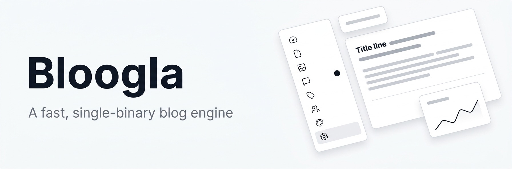
</p>

<p align="center">
  <a href="https://github.com/dincertekin/bloogla/stargazers"></a>
  <a href="https://github.com/dincertekin/bloogla/releases/latest"></a>
  <a href="https://github.com/dincertekin/bloogla/actions/workflows/ci.yml"></a>
  <a href="LICENSE"></a>
  
</p>

<p align="center">
  <b>Everything a blog needs, in one small program.</b><br>
  Copy it to a server, open the link it prints, and start writing.
</p>

<p align="center">
  <a href="#quick-start">Quick start</a> ·
  <a href="#features">Features</a> ·
  <a href="#themes">Themes</a> ·
  <a href="docs/running.md">Docs</a> ·
  <a href="docs/translating.md">Translate</a> ·
  <a href="CONTRIBUTING.md">Contributing</a> ·
  <a href="#would-you-like-to-support-bloogla">Support</a>
</p>

---

Bloogla is a lighter WordPress for people who want a fast, good-looking
website without the upkeep. One file runs the site, the admin panel and the
HTTPS certificate: no PHP, no database server, no plugins.

- **Simple** — set up in the browser, write in a visual editor, done.
- **Fast** — pages are tiny and served in milliseconds, even on the smallest server.
- **Safe** — strict security by default, two-factor login, signed updates.
- **Yours** — your data in one folder, one-click backups, no tracking.

## Screenshots

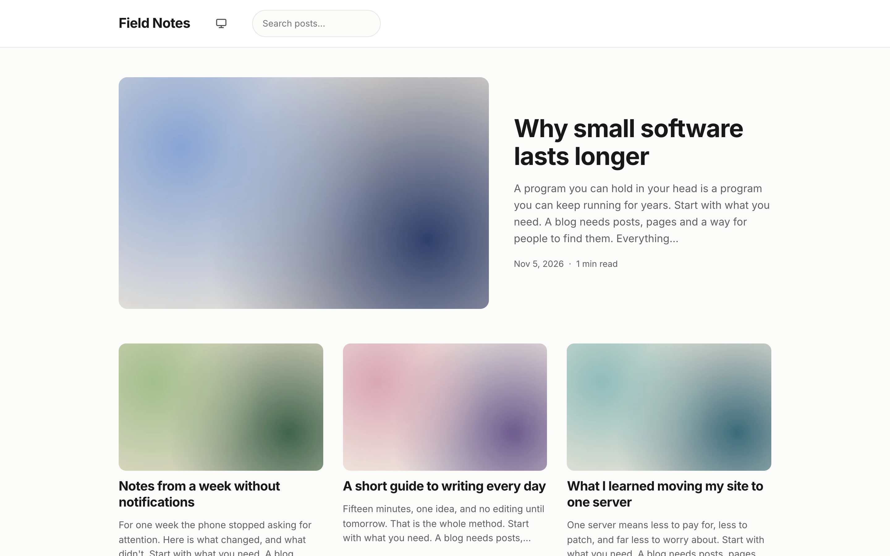

<table>
  <tr>
    <td width="50%">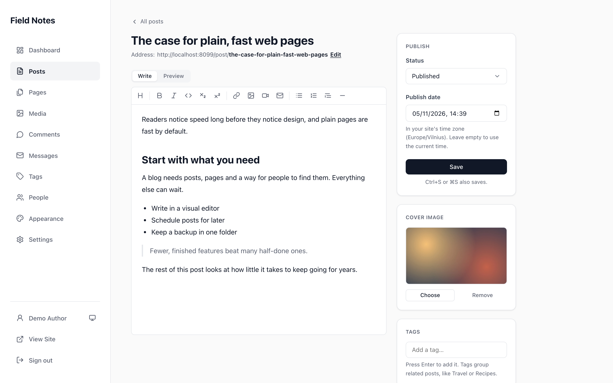<br><b>The visual editor</b></td>
    <td width="50%">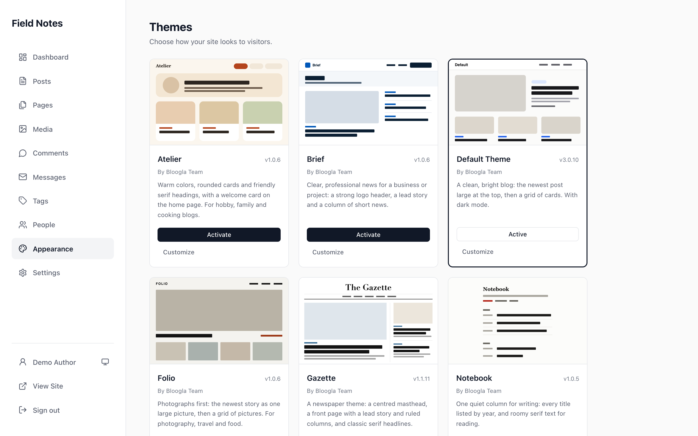<br><b>Themes</b></td>
  </tr>
</table>

<sub>Screenshots use demo posts.</sub>

## Quick start

**On Windows:** download `bloogla-x86_64-windows.exe` from the
[latest release](https://github.com/dincertekin/bloogla/releases/latest) and
open it. The setup page opens in your browser
([what to click the first time](docs/running.md#on-your-computer)). On a
Mac, use Docker.

**On a server with Docker** (point your domain at the server first):

```bash
docker run -d --name bloogla --restart unless-stopped -p 80:80 -p 443:443 \
  -v bloogla:/app -e BLOOGLA_TLS_DOMAINS=example.com ghcr.io/dincertekin/bloogla
docker logs bloogla   # open the setup link it prints
```

**On a server without Docker:** download the program from the
[latest release](https://github.com/dincertekin/bloogla/releases/latest):

```bash
chmod +x bloogla-x86_64-linux
BLOOGLA_TLS_DOMAINS=example.com ./bloogla-x86_64-linux
```

HTTPS comes from Let's Encrypt by itself. More in
[Running Bloogla](docs/running.md).

## Features

|                     |                                                                                              |
| ------------------- | -------------------------------------------------------------------------------------------- |
| **Writing**         | Visual editor, drafts and scheduling, a private link to share a draft, pages, tags, images and short videos, revisions, a trash, changing many posts at once, YouTube and Vimeo embeds, formulas (`$E = mc^2$`, drawn with KaTeX) |
| **Your site**       | Seven themes with light and dark mode (visitors can switch), a page or your latest posts as the home page, menus, search, comments and a contact form with spam protection, an archive of every post by year, RSS, sitemap |
| **Found on Google** | Meta tags, Open Graph, structured data, clean addresses with automatic redirects (and your own, for old addresses), verification tags for Google, Bing and Mastodon |
| **Analytics**       | Views and referring sites per day, without cookies or personal data                          |
| **People**          | Admins, editors and authors, two-factor login, password reset by email, light or dark admin for each person |
| **Languages**       | English, Deutsch, Français, Lietuvių and Türkçe, for the admin panel, the theme and emails  |
| **Moving in and out** | Import from WordPress (posts, pages, tags, comments, images, old addresses), export as a WordPress file or Markdown |
| **Peace of mind**   | Built-in HTTPS, daily backups, one-click `.zip` backup and restore, signed updates you can install from Settings |

## Themes

<table>
  <tr>
    <td align="center" width="25%">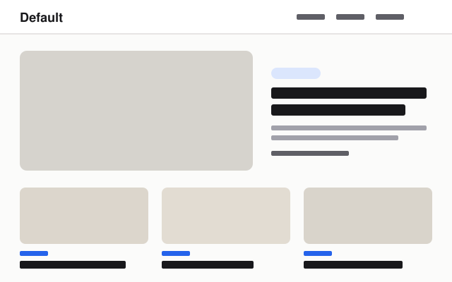<br><b>Default</b><br>A clean blog with a featured post</td>
    <td align="center" width="25%">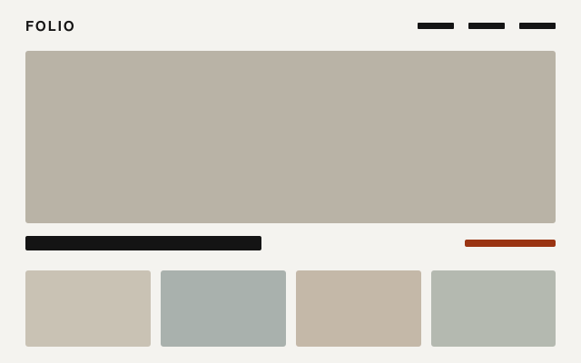<br><b>Folio</b><br>Photographs first</td>
    <td align="center" width="25%">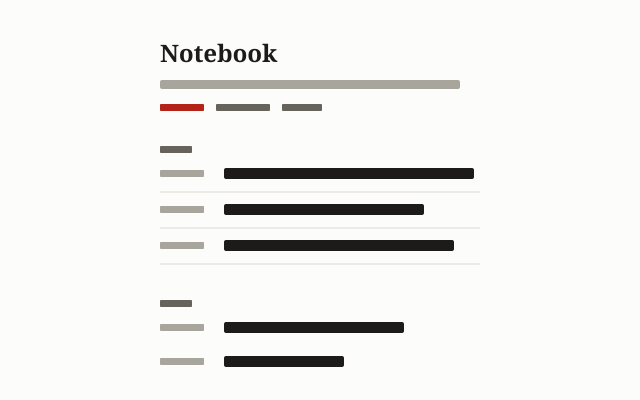<br><b>Notebook</b><br>Quiet writing, titles by year</td>
    <td align="center" width="25%">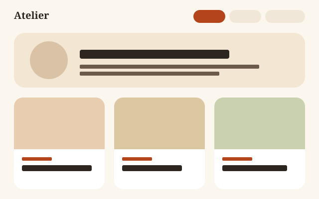<br><b>Atelier</b><br>Warm, rounded and friendly</td>
  </tr>
  <tr>
    <td align="center" width="25%">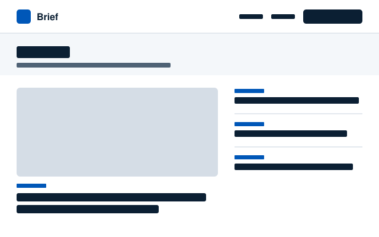<br><b>Brief</b><br>News for a business or project</td>
    <td align="center" width="25%">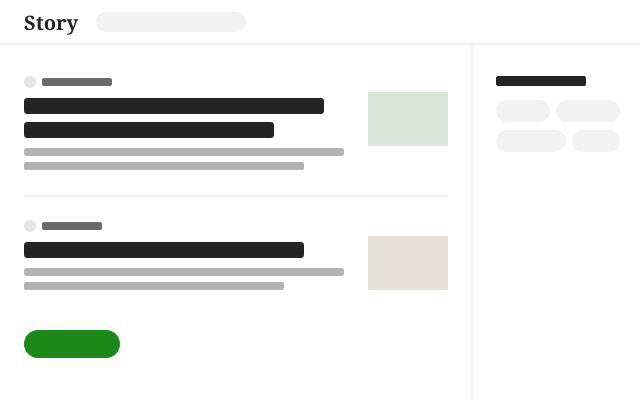<br><b>Story</b><br>Calm reading, Medium-style</td>
    <td align="center" width="25%">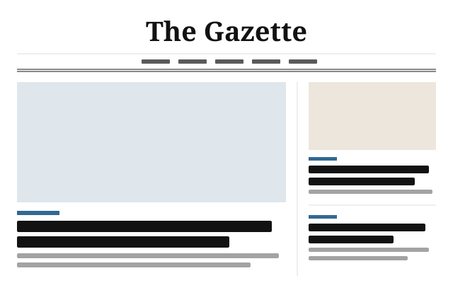<br><b>Gazette</b><br>A newspaper front page</td>
    <td></td>
  </tr>
</table>

Pick one in **Appearance** and change its logo, colors and texts without
touching code. Themes are plain HTML and CSS:
[make your own](docs/themes.md).

## Updating

Download a backup first (**Settings → Backup**). Then:

- **Linux:** **Settings → Updates → Install**. It checks the new version is
  a genuine, signed Bloogla and restarts in a few seconds.
- **Docker:** `docker pull ghcr.io/dincertekin/bloogla`, then start the
  container again with the same command.
- **Windows:** replace the `.exe` with the new one.

[More about updating](docs/running.md#updating).

## Documentation

- [Running Bloogla](docs/running.md): servers, updates, backups, moving from WordPress
- [Writing themes](docs/themes.md)
- [Translating](docs/translating.md): no programming needed
- [Security](docs/security.md)
- [Contributing](CONTRIBUTING.md)

## Contributing

Bug reports, translations, themes and code are all welcome.

- **Translate:** add your language in the browser with the
  [translation guide](docs/translating.md).
- **Code:** start with [CONTRIBUTING.md](CONTRIBUTING.md); `cargo run` gives
  you a local site.
- **Security issue?** Please report it [privately](SECURITY.md).

Built with [Rust](https://www.rust-lang.org), [axum](https://github.com/tokio-rs/axum),
[SQLite](https://sqlite.org) and [htmx](https://htmx.org).

## Would you like to support Bloogla?

Bloogla is free, and it stays free. If it helps you, you can:

- **[Buy me a coffee](https://buymeacoffee.com/dincertekin)**, or click
  **Sponsor** at the top of the
  [GitHub page](https://github.com/dincertekin/bloogla): it keeps the work
  going.
- **Give it a star** on GitHub, so more people find it.
- **Tell a friend** who wants a website without the hassle.

Thank you!

## Star history

<a href="https://star-history.com/#dincertekin/bloogla&Date">
  <picture>
    <source media="(prefers-color-scheme: dark)" srcset="https://api.star-history.com/svg?repos=dincertekin/bloogla&type=Date&theme=dark">
    
  </picture>
</a>

## License

[MIT](LICENSE) © Dinçer Tekin
